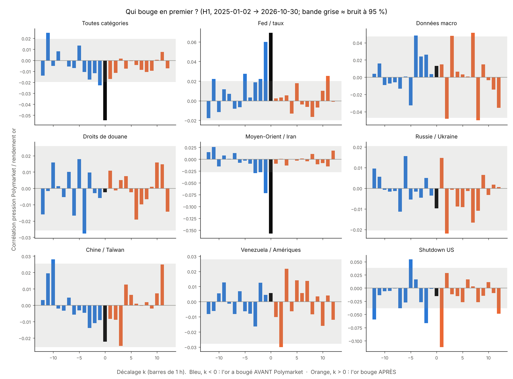
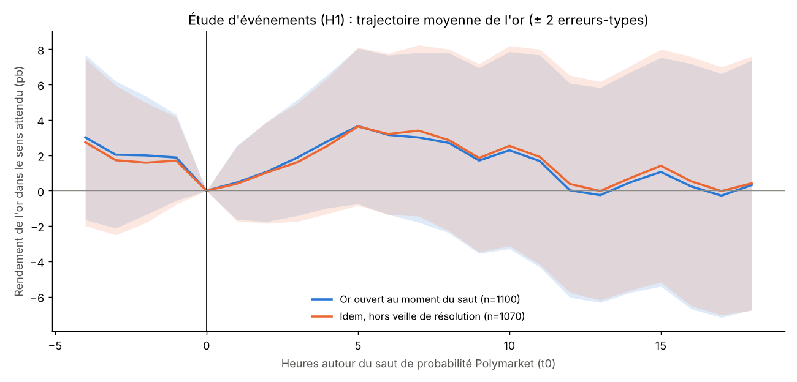

# Phase 0 — Polymarket précède-t-il l'or (XAUUSD) ?

*Rapport de recherche — 24 novembre 2026. Toutes les données sont réelles et téléchargées depuis les sources publiques ; aucune valeur n'est simulée.*

## Verdict

> **Non : on ne peut pas trader l'or en suivant les sauts de probabilité Polymarket.**
> Sur 1 507 « nouvelles » détectées entre janvier 2025 et octobre 2026, aucun horizon (15 min → 3 jours) ne montre un rendement de l'or exploitable *après* le saut, que la direction soit fixée a priori ou réestimée dynamiquement. Aucun des 32 tests par catégorie ne survit à la correction pour tests multiples.
>
> Polymarket est surtout **en retard ou simultané** : sur la Fed et sur l'Iran, l'or (et les taux) bougent **une heure avant** que les probabilités ne s'ajustent.
>
> En revanche, trois résultats sont **utiles** pour le système : (1) le lien Polymarket ↔ or existe *au même moment* et il **change de signe selon le régime** ; (2) un saut Polymarket annonce une **volatilité de l'or un peu plus élevée** ; (3) une hypothèse reste **non testée** : l'activité inhabituelle de portefeuilles avant les annonces (données on-chain).

## Données

| Source | Contenu | Période | Résolution |
|---|---|---|---|
| Polymarket Gamma + CLOB | 715 marchés liés à l'or (≈ 9 Md$ de volume), 8 catégories | 2025-01 → 2026-11 | 5 min |
| Dukascopy | XAUUSD BID | 2025-01-01 → 2025-05-13 | **M1 → M5** (débit de la source limité à ~1 fichier/min) |
| Dukascopy | XAUUSD BID | 2025-01-02 → 2026-10-30 | **H1** (novembre 2026 pas encore publié) |

- **Direction a priori** : 428 marchés reçoivent une direction écrite *avant* tout calcul, à partir du seul texte de la question (`research/labels.py`) : escalade = or +, désescalade = or −, baisse de taux = or +, hausse = or −, etc. 287 marchés ambigus (élections, nominations, tranches) sont exclus.
- **Saut** : |Δp| ≥ 5 points ET |Δlogit| ≥ 0,25 ET z ≥ 4 par rapport à la volatilité passée du marché. Les sauts à moins de 15 min d'écart sont regroupés en une même « nouvelle ».
- **Garde-fous** : entrée seulement *après* l'observation (t0 + 5 min en M5, prochaine barre en H1), **dérive récente de l'or retirée** (20 jours passés), statistiques t sur **moyennes journalières** (pas de double comptage), coûts de **1,5 pb** aller-retour, **2026 comme période hors échantillon**.

## Résultat 1 — Qui bouge en premier ?



| Catégorie | Lien simultané (k = 0) | L'or mène (k = −1) | Polymarket mène (k > 0) |
|---|---|---|---|
| Fed / taux | **+0,069 (t = 4,0)** ✔ sens attendu | **+0,060 (t = 4,7)** | aucun |
| Moyen-Orient / Iran | **−0,158 (t = −7,1)** ✘ sens *inverse* | **−0,072 (t = −4,1)** | aucun |
| Droits de douane | ≈ 0 | M5 : l'or bouge dans l'heure avant le saut (t = 2,6) | aucun |
| Autres | non significatif | — | aucun robuste |

Granger horaire : l'or « cause » Polymarket sur la Fed (p < 0,0001) et le Moyen-Orient (p < 0,0001). Dans l'autre sens, seul le shutdown US ressort (p < 0,0001), mais avec un signe opposé à l'intuition, sur 47 jours, et pendant la période de forte volatilité de l'or d'octobre 2025. Je le classe comme non fiable.

## Résultat 2 — Rendement après un saut



| Groupe (H1) | n | +1 h | +4 h | +1 j | +3 j |
|---|---|---|---|---|---|
| Tous | 1 507 | +0,4 pb (t 1,3) | +1,5 (t −0,3) | +5,6 (t 0,2) | +11,5 (t 0,6) |
| 2025 | 784 | +0,7 (t 0,6) | +1,0 (t −0,2) | +2,4 (t −1,0) | +3,3 (t −0,5) |
| 2026 (hors échantillon) | 723 | 0,0 (t 1,2) | +2,1 (t −0,3) | +9,1 (t 1,1) | +20,5 (t 1,1) |
| Direction dynamique | 790 | +0,2 (t −0,2) | +2,5 (t 1,9) | −1,0 (t 0,3) | −3,0 (t −0,2) |

*Rendement anormal de l'or dans le sens prévu, en points de base ; t calculé sur moyennes journalières.*

- Après coûts, l'espérance est **nulle ou négative** (profit factor 0,9 à 1,1).
- Les moyennes positives à 1-3 jours viennent de **quelques journées extrêmes** : leur t reste inférieur à 1,2.
- En M5 (janvier-mai 2025, 645 nouvelles), même conclusion : t compris entre −1,0 et +0,8 de 15 min à 1 jour.
- Correction de Benjamini-Hochberg sur 32 tests catégorie × horizon : **0 significatif**. Le meilleur, Russie/Ukraine à 1 jour (t = −2,24, p = 0,026), a un seuil de 0,0016.

## Résultat 3 — Le lien change de régime (le plus important)

Corrélation simultanée « pression d'escalade Moyen-Orient » / or, par trimestre :

| 2025 T2 | 2025 T4 | 2026 T1 | 2026 T2 | 2026 T3 | 2026 T4 |
|---|---|---|---|---|---|
| **+0,11** | −0,11 | **−0,16** | **−0,25** | −0,08 | +0,05 |

- En juin 2025 (guerre Israël-Iran de 12 jours), l'escalade faisait monter l'or (valeur refuge).
- Pendant la guerre États-Unis/Iran de 2026, c'est l'inverse : quand la paix devenait plus probable, l'or **montait**. Exemples : le 23 mars 2026, 22 marchés « fin du conflit » bougent ensemble et l'or varie de 2,5 % dans l'heure ; le 7 avril 2026 (cessez-le-feu), +2,4 %.
- **Mécanisme probable** : la guerre fait monter le pétrole, puis l'inflation anticipée, d'où une Fed plus restrictive et un dollar plus fort, ce qui pèse sur l'or. La paix produit l'effet inverse.
- **Conséquence** : une règle fixe « géopolitique = BUY » aurait été **perdante en 2026**. C'est précisément le cas que tu avais anticipé : un événement en apparence haussier ne doit pas déclencher un BUY automatiquement.

## Résultat 4 — Volatilité

Après un saut (or ouvert), le mouvement absolu de l'or est supérieur à la normale pour le même jour de la semaine et la même heure :

| | +1 h | +4 h |
|---|---|---|
| M5 (465 sauts) | ×1,12 (54 % au-dessus) | ×1,19 (56 % au-dessus) |
| H1 (1 100 sauts) | ×1,06 (51 %) | ×1,07 (53 %) |

L'effet est faible mais cohérent. Il sert à la **gestion du risque** (stops plus larges, taille réduite, prudence), pas à choisir une direction.

## Limites

1. **M5 limité à 4,5 mois** par la source gratuite. La conclusion H1 est solide, la conclusion « à la minute » l'est moins.
2. Prix Polymarket échantillonnés à 5 min, **sans profondeur du carnet** : on ne peut pas encore filtrer les sauts provoqués par un seul petit ordre. Cela ajoute du bruit, qui joue plutôt contre la découverte d'un signal.
3. Les directions a priori viennent de règles textuelles : certaines sont discutables. Le test dynamique sert à couvrir ce point.
4. **Non testé ici** : les données de portefeuilles on-chain (trades inhabituels *avant* l'annonce), Kalshi, et les marchés à faible volume (moins de 250 k$).
5. XAUUSD BID Dukascopy. Les prix d'un courtier MT5 diffèrent légèrement, ce qui ne change pas les conclusions.

## Ce que ça change pour le système

| Idée initiale | Décision |
|---|---|
| « Anomalie Polymarket → alerte BUY/SELL » | **Abandonné** comme signal directionnel autonome : non démontré. |
| Direction fondamentale fixe par type d'événement | **Remplacée** par un lien **dynamique** estimé en continu, Polymarket ↔ or / DXY / taux, avec détection de changement de régime. |
| Polymarket comme déclencheur | Polymarket devient un **capteur de contexte et de risque** : « nouvelle majeure en cours sur X, volatilité de l'or attendue en hausse, lien actuel de signe Y ». Alerte **INFO / RISQUE**, pas un trade. |
| Signal de trade | Doit venir d'une **confirmation de prix** (structure M5-H1, DXY, taux) et d'un modèle calibré, testé en paper trading. Polymarket n'est qu'une variable parmi d'autres. |
| Détection de comportements inhabituels (portefeuilles) | **Seule hypothèse « en avance » restante**, à tester en Phase 0b sur les grands événements (Maduro en janvier 2026, frappes sur l'Iran en février 2026, cessez-le-feu d'avril 2026). Les données `data-api v2` donnent l'adresse de chaque trade. |

## Reproduire

```bash
cd gold-intel && python -m venv .venv && . .venv/bin/activate && pip install -r requirements.txt
python -m research.data.polymarket                       # univers + historiques (≈ 20 min)
python -c "from datetime import date; from research.data.dukascopy import download_hourly; download_hourly('XAUUSD', date(2025,1,1), date(2026,11,22))"
python -m research.data.dukascopy XAUUSD 2025-01-01 2025-05-13   # M1 (lent)
python -m research.phase0_leadlag M5 H1
python -m research.phase0_dynamic
```

Fichiers de résultats : `summary_*.json`, `leadlag_*.csv`, `granger_*.csv`, `events_*.csv`, `volatility.json`.
